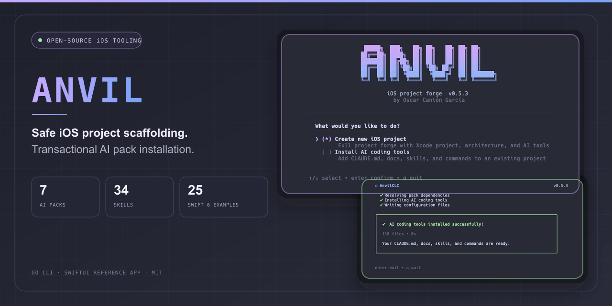
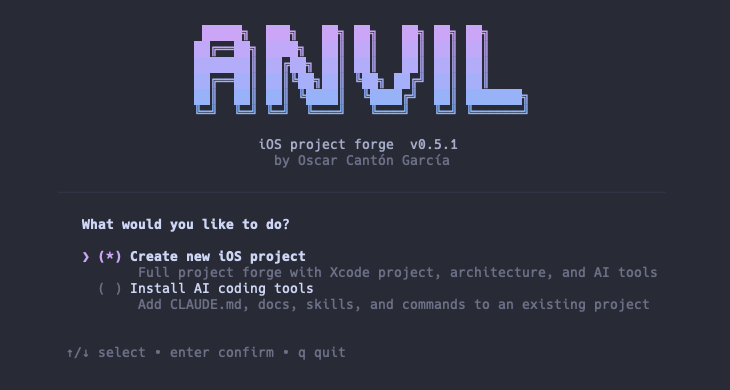
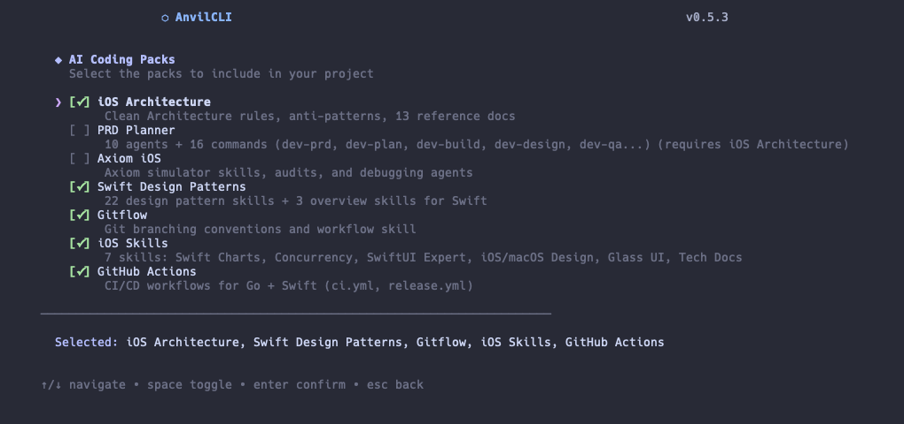
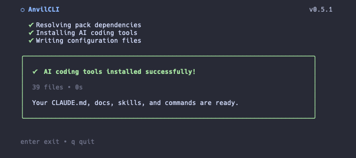
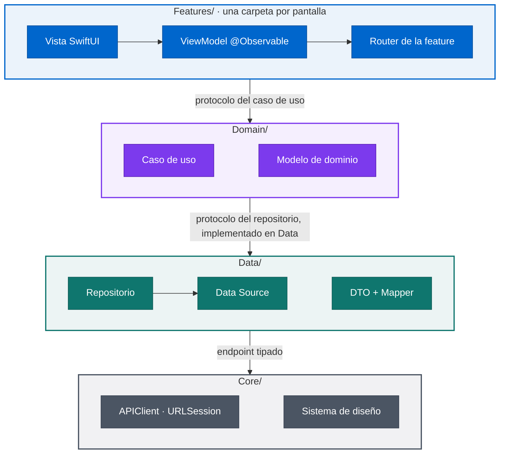
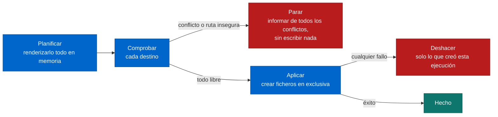

<div align="center">



**Una CLI en Go que genera proyectos iOS con la arquitectura que uso en producción:**<br>
**Clean Architecture por capas, MVVM, navegación tipada e inyección de dependencias a mano, en Swift 6.**

[](https://github.com/magnoscg/anvil/releases)
[](https://github.com/magnoscg/anvil/actions/workflows/ci.yml)
[](go.mod)
[](templates/base)
[](templates/base)
[](templates/ai-packs/PROVENANCE.yml)
[](LICENSE)

[**Instalar**](#-instalar) · [**El asistente**](#-el-asistente) · [**Qué obtienes**](#-qué-obtienes) · [**Packs de IA**](#-packs-de-ia) · [**Seguridad**](#-seguro-por-diseño) · [**Sobre mí**](#-sobre-mí) · [**English**](README.md)

</div>

## ✨ Puntos clave

<table>
<tr>
<td width="33%" valign="top">

**🏗️ Un proyecto que compila desde el primer día**

`anvil init` escribe un `.xcodeproj` nativo con las capas App, Core, Domain, Data y Features, un scheme por entorno y targets de tests unitarios y de UI. Sin Tuist ni XcodeGen.

</td>
<td width="33%" valign="top">

**🧩 Un comando por feature**

`anvil feature Profile` añade modelo, caso de uso, repositorio, data source, DTO, mappers, ViewModel, vista, router, factory, tests y mocks, cableados siempre igual.

</td>
<td width="33%" valign="top">

**🤖 Packs de IA que conocen la arquitectura**

Siete packs opcionales dan a Claude Code un `CLAUDE.md`, 13 documentos de referencia, agentes, comandos y 34 skills que describen el código que genera Anvil.

</td>
</tr>
<tr>
<td width="33%" valign="top">

**🛡️ Transaccional por diseño**

La generación planifica y comprueba cada destino antes de escribir, nunca sobrescribe tus ficheros y solo deshace lo que creó la ejecución actual.

</td>
<td width="33%" valign="top">

**📱 Una app de ejemplo real**

[`Example/`](Example) es una app SwiftUI que funciona, con 253 casos de Swift Testing. Es el mismo código que explica a fondo [iOS Architecture Reference](https://github.com/magnoscg/ios-architecture-reference).

</td>
<td width="33%" valign="top">

**🔍 Verificado en CI**

Cada push ejecuta vet, tests con detector de carreras y de integración, un análisis de vulnerabilidades para darwin, la comprobación de procedencia de skills y el build y los tests Swift del Example.

</td>
</tr>
</table>

## 🚀 Instalar

**Requisitos:** macOS con Xcode 26 (los proyectos generados son proyectos de Xcode). Go 1.26+ solo si instalas desde el código fuente.

```bash
go install github.com/magnoscg/anvil/cmd/anvil@latest
```

El binario queda en `$(go env GOPATH)/bin`; asegúrate de que está en tu `PATH`.

<details>
<summary><b>Otras formas de instalar</b></summary>

Descarga un binario precompilado (en Macs Intel, cambia `arm64` por `amd64`):

```bash
gh release download --repo magnoscg/anvil --pattern "anvil_*_darwin_arm64.tar.gz"
tar xzf anvil_*_darwin_arm64.tar.gz
./install.sh
```

Compila desde el código fuente:

```bash
git clone https://github.com/magnoscg/anvil.git
cd anvil
make build        # binario en ./bin/anvil
```

</details>

## 🧙 El asistente

```bash
anvil init                 # crea un proyecto, o añade herramientas de IA a uno existente
anvil feature Profile      # añade una feature dentro de un proyecto creado con anvil init
anvil version
```

<p align="center">
  
  
  
</p>

`anvil init` ofrece dos modos:

- **Create new iOS project**: nombre, bundle ID, versiones de iOS y Swift, schemes, SwiftData y una feature de ejemplo opcionales, y después los packs de IA.
- **Install AI coding tools**: añade `CLAUDE.md`, documentos, skills y comandos a un proyecto que ya tienes, sin tocar su código.

`anvil feature <Nombre>` pregunta si añadir un data source local (UserDefaults), almacenamiento en Keychain, un RouteResolver y tests de UI; después escribe la feature e indica los pasos para conectarla.

## 📦 Qué obtienes

La app generada sigue las mismas capas que el Example. Cada capa habla con la siguiente a través de un protocolo, así que las vistas nunca ven un repositorio y los ViewModels nunca ven un DTO.



| Área | Qué incluye el proyecto generado |
| --- | --- |
| **App** | Raíz de composición en `@main`, `AppDependencies`, ficheros `.xcconfig` por entorno, un `AppRouter` tipado y un coordinador de navegación preparado para deep links |
| **Core** | `APIClient` con cadena de interceptores y reintentos idempotentes, SSL pinning que falla cerrado, `NetworkMonitor`, helper de Keychain y tokens del sistema de diseño |
| **Domain / Data** | `DomainError` y el mapeo en Data que mantiene los tipos de red fuera de Domain |
| **Features** | Una carpeta por pantalla: `DI/`, `UI/`, `Presentation/` y `Navigation/` |
| **Tests** | Un target de Swift Testing que replica el árbol de código, con mocks por feature |
| **Opcional** | Stack de SwiftData, una feature de ejemplo, tests de UI por feature |

<details>
<summary><b>Estructura del proyecto generado</b></summary>

```text
<ProjectName>/
├── <ProjectName>/
│   ├── App/            punto de entrada, configuración, navegación
│   ├── Core/           red, seguridad, sistema de diseño, UI compartida
│   ├── Domain/         modelos, casos de uso y protocolos de repositorio
│   ├── Data/           repositorios, data sources, DTOs y mappers
│   ├── Features/       pantallas: UI, ViewModels, routers y factories
│   └── Resources/      assets y String Catalog
├── <ProjectName>Tests/ tests unitarios que replican el árbol de código
├── <ProjectName>UITests/ UI tests: Page Objects y tests de pantalla
├── Shared/             se compila en la app y en los UI tests: ids de accesibilidad, claves de lanzamiento
├── <ProjectName>.xcodeproj
└── .anvil.yml          marcador que lee anvil feature
```

</details>

## 🤖 Packs de IA

Los packs son opcionales y se pueden añadir al crear el proyecto o más tarde, en el modo de herramientas.

| Pack | Contenido |
| --- | --- |
| `ios-architecture` | `CLAUDE.md` con las reglas y antipatrones de la arquitectura, y 13 documentos de referencia |
| `prd-planner` | 10 agentes y 16 comandos para un flujo PRD → plan → build (`/dev-prd`, `/dev-plan`, `/dev-build`, `/dev-qa`…) |
| `axiom-ios` | Conexión con las skills de simulador, auditorías y agentes de depuración de [Axiom](https://github.com/CharlesWiltgen/Axiom) |
| `swift-design-patterns` | 22 skills de patrones de diseño y 3 skills de visión general |
| `ios-skills` | 7 skills: Swift Charts, concurrencia en Swift, SwiftUI, guías de diseño de iOS y macOS, UI de cristal y documentación técnica |
| `gitflow` | Convenciones de ramas de Git y una skill de flujo de trabajo |
| `github-actions` | CI que compila y prueba el primer scheme, y un workflow de releases |

Las skills se instalan por proyecto (`.claude/skills/`) o de forma global (`~/.claude/skills/`). Una skill global que ya instaló una ejecución anterior se reutiliza; si la tuya es distinta, Anvil la conserva y te avisa.

<details>
<summary><b>Requisitos de terceros y procedencia</b></summary>

Algunos packs configuran herramientas que **no se incluyen aquí**:

- **[Axiom](https://github.com/CharlesWiltgen/Axiom)**, de Charles Wiltgen (MIT). El pack `axiom-ios` escribe convenciones para sus skills y agentes, pero no incluye nada de su código:
  ```bash
  claude plugin marketplace add CharlesWiltgen/Axiom
  claude plugin install axiom@axiom-marketplace
  ```
- **sosumi MCP**, que `axiom-ios` usa para consultar la documentación de Apple.
- **ui-ux-pro-max**, que usa el agente de diseño de `prd-planner`.

Los packs que hacen referencia a una herramienta que falta se generan igual; solo esos comandos no funcionarán.

Las 34 skills incluidas están registradas en [`PROVENANCE.yml`](templates/ai-packs/PROVENANCE.yml). El contenido original tiene licencia MIT. Las tres skills MIT de terceros, sin modificar, están fijadas a commits exactos y listadas en [`THIRD_PARTY_NOTICES.md`](THIRD_PARTY_NOTICES.md); al elegir su pack, los avisos se instalan también en tu proyecto.

</details>

## 🛡️ Seguro por diseño

Un generador de proyectos trabaja dentro de las carpetas de otras personas, así que Anvil trata cada escritura como una transacción:



- El directorio del proyecto se crea en exclusiva; una carpeta existente nunca se reutiliza ni se borra.
- Los nombres de proyecto, schemes y features se validan antes de escribir nada, así que `../` nunca puede escaparse.
- Nunca se sobrescriben skills, comandos, documentos, workflows ni `CLAUDE.md` existentes. `.claude/settings.json` se fusiona manteniendo tus valores y se reemplaza de forma atómica.
- Se rechazan los destinos y directorios padre que sean enlaces simbólicos. Los ficheros globales solo se publican cuando el proyecto y su marcador ya existen.
- Un `anvil feature` fallido borra los ficheros y carpetas que creó, así que basta con volver a ejecutarlo.
- `anvil init` termina con error cuando falla la generación, para que los scripts y el CI lo detecten.

## 🧰 Stack técnico

| Área | Qué usa |
| --- | --- |
| CLI | Go 1.26 · [Cobra](https://github.com/spf13/cobra) · [Bubble Tea](https://github.com/charmbracelet/bubbletea) y [Lip Gloss](https://github.com/charmbracelet/lipgloss) · [Huh](https://github.com/charmbracelet/huh) |
| Plantillas | `text/template` embebido con `go:embed`, tests con ficheros golden |
| App generada | Swift 6 · SwiftUI · Observation · Swift Testing · `.xcodeproj` nativo |
| Calidad | `go vet` · detector de carreras · suite de integración · `govulncheck` · GitHub Actions fijadas por SHA |
| Releases | GoReleaser, darwin arm64 y amd64, condicionadas al CI y a `main` |

## 🛠️ Desarrollo

| Comando | Qué hace |
| --- | --- |
| `make build` | Compila `./bin/anvil` |
| `make test` | Ejecuta los tests unitarios |
| `make test-integration` | Ejecuta la suite de integración con las plantillas reales (sin Xcode) |
| `./scripts/validate-skill-content.sh` | Comprueba el inventario de skills, su procedencia y 25 ejemplos independientes en Swift 6 |
| `make validate-public-assets` | Comprueba la imagen de vista previa y los recursos del README |
| `make all` | Formato, lint, tests, validación de recursos y build |

Tras cambiar cualquier cosa en `templates/`, regenera los ficheros golden:

```bash
go test ./internal/generator/ -run TestGolden -update
```

<details>
<summary><b>Estructura del repositorio</b></summary>

```text
cmd/anvil/          punto de entrada de la CLI (comandos Cobra)
internal/
  config/           modelos de datos, configuración y validación de nombres
  deps/             detección de dependencias del sistema
  generator/        renderizado de plantillas, planificación de packs, proyecto Xcode, rollback
  feature/          generación de features
  tui/              pantallas del asistente con Bubble Tea
templates/          plantillas embebidas: base, swiftdata, example, feature, ai-packs
Example/            la app SwiftUI de referencia
```

</details>

Las contribuciones siguen Gitflow: crea una rama `feature/*` desde `develop` y abre la pull request contra `develop`. Consulta [CONTRIBUTING](CONTRIBUTING.md).

## 📚 Documentación

- [Documentación de AnvilCLI](docs/AnvilCLI-Documentation.md): comandos, asistente, configuración, packs, pipeline de generación y plantillas
- [iOS Architecture Reference](https://github.com/magnoscg/ios-architecture-reference): la arquitectura que hay detrás del código generado, explicada
- [Contribuir](CONTRIBUTING.md) · [Política de seguridad](SECURITY.md) · [Asset provenance](ASSET_PROVENANCE.md) · [Avisos de terceros](THIRD_PARTY_NOTICES.md)

## 📅 Historia del proyecto

| Cuándo | Hito |
| --- | --- |
| **Enero de 2026** | Empieza el trabajo en mi espacio privado de arquitectura: convenciones, documentación y la app de referencia |
| **Marzo de 2026** | Nace Anvil para generar esa arquitectura, con la app de referencia como su `Example/` |
| **Julio de 2026** | Se publica aquí como edición pública, release `0.5.1` |
| **Agosto de 2026** | Generación e instalación de packs transaccionales, procedencia de recursos y skills, release `0.6.0` |
| **Noviembre de 2026** | Los proyectos generados siguen la arquitectura de referencia: Domain y Data por concepto, navegación por ventana y red reforzada, release `0.7.0` |
| **Noviembre de 2026** | Los proyectos generados traen un target de UI tests conectado de extremo a extremo y el pack de arquitectura se reescribe en 12 documentos más cortos, release `0.8.0` |
| **Noviembre de 2026** | La app `Example/` vuelve a seguir el pack y sus tests compilan con Xcode 27.2; los UI tests pasan a ser opcionales, solo para flujos que cuestan dinero o datos, release `0.8.1` |

El historial privado no se trajo, por eso el primer commit de este repositorio es la edición pública `0.5.1`.

## 👋 Sobre mí

Soy **Oscar Canton**, Senior iOS Engineer en Madrid. De día lidero un equipo de iOS y en mi tiempo construyo mis propias apps bajo **OgamLabs**. Anvil es como empiezo cada proyecto nuevo: las decisiones se toman una vez, se escriben y se generan igual cada vez.

[Portfolio](https://ogamlabs.com) · [LinkedIn](https://www.linkedin.com/in/oscarcantongarcia/) · [GitHub](https://github.com/magnoscg) · [Email](mailto:soporte@ogamlabs.com)

Más de mi trabajo: [iOS Architecture Reference](https://github.com/magnoscg/ios-architecture-reference) · [Caso de estudio CholloGas](https://github.com/magnoscg/chollogas-case-study) · [Caso de estudio Hilo](https://github.com/magnoscg/hilo-case-study)

## 📄 Licencia

[MIT](LICENSE) © Oscar Canton. Las skills de terceros conservan sus propios avisos MIT; consulta los [avisos de terceros](THIRD_PARTY_NOTICES.md).
