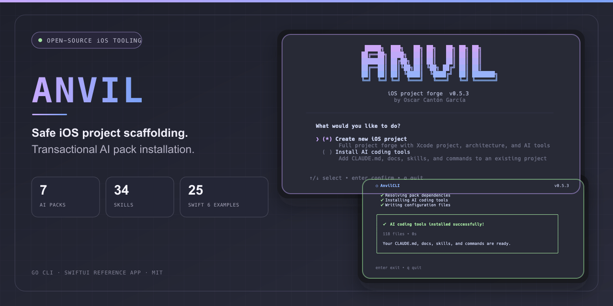
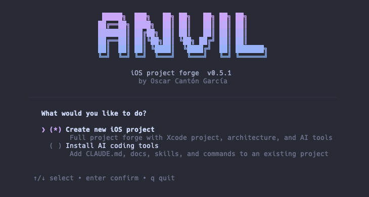
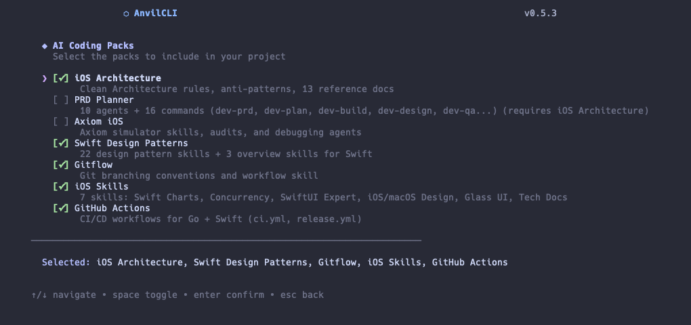
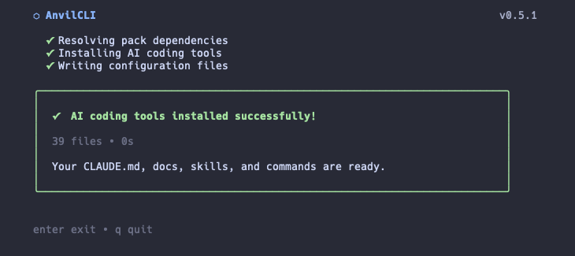
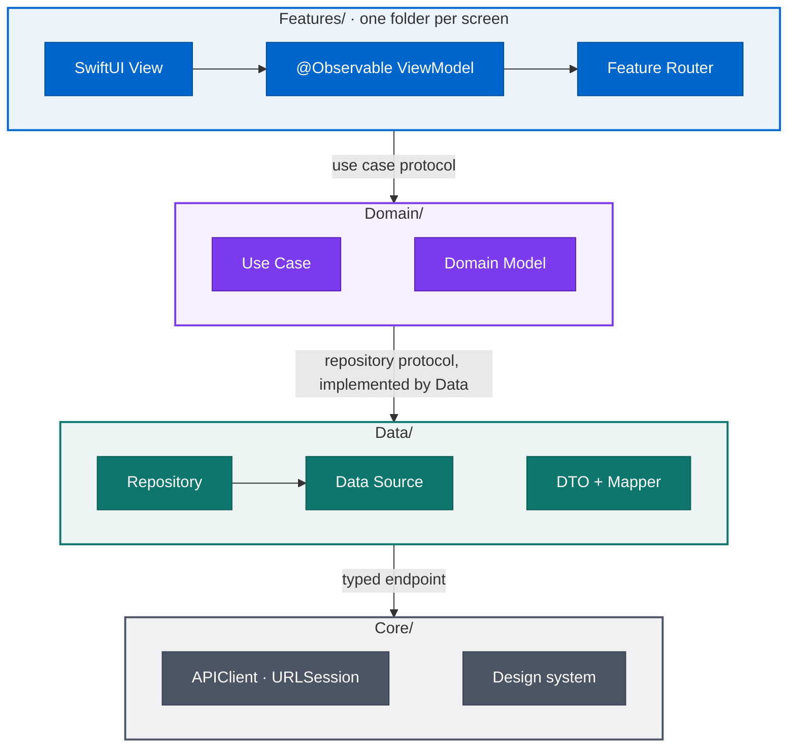
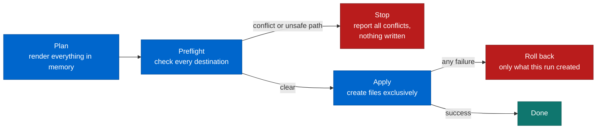

<div align="center">



**A Go CLI that scaffolds iOS projects with the architecture I use in production:**<br>
**layered Clean Architecture, MVVM, typed navigation and hand-wired dependency injection, in Swift 6.**

[](https://github.com/magnoscg/anvil/releases)
[](https://github.com/magnoscg/anvil/actions/workflows/ci.yml)
[](go.mod)
[](templates/base)
[](templates/base)
[](templates/ai-packs/PROVENANCE.yml)
[](LICENSE)

[**Install**](#-install) · [**The wizard**](#-the-wizard) · [**What you get**](#-what-you-get) · [**AI packs**](#-ai-packs) · [**Safety**](#-safe-by-construction) · [**About me**](#-about-me) · [**Español**](README.es.md)

</div>

## ✨ Highlights

<table>
<tr>
<td width="33%" valign="top">

**🏗️ A project that builds on day one**

`anvil init` writes a native `.xcodeproj` with App, Core, Domain, Data and Features layers, schemes per environment, and unit and UI test targets. No Tuist or XcodeGen needed.

</td>
<td width="33%" valign="top">

**🧩 One command per feature**

`anvil feature Profile` adds model, use case, repository, data source, DTO, mappers, ViewModel, view, router, factory, tests and mocks, wired the same way every time.

</td>
<td width="33%" valign="top">

**🤖 AI packs that know the architecture**

Seven optional packs give Claude Code a `CLAUDE.md`, 13 reference docs, agents, commands and 34 skills that describe the code Anvil generates.

</td>
</tr>
<tr>
<td width="33%" valign="top">

**🛡️ Transactional by design**

Generation plans and checks every destination before writing, never overwrites your files, and rolls back only what the current run created.

</td>
<td width="33%" valign="top">

**📱 A real example app**

[`Example/`](Example) is a working SwiftUI app with 253 Swift Testing cases. It is the same code that [iOS Architecture Reference](https://github.com/magnoscg/ios-architecture-reference) explains in depth.

</td>
<td width="33%" valign="top">

**🔍 Verified in CI**

Every push runs vet, race-detected and integration tests, a vulnerability scan for darwin, the skill provenance check, and the Example's build and Swift tests.

</td>
</tr>
</table>

## 🚀 Install

**Requirements:** macOS with Xcode 26 (the generated projects are Xcode projects). Go 1.26+ only if you install from source.

```bash
go install github.com/magnoscg/anvil/cmd/anvil@latest
```

The binary lands in `$(go env GOPATH)/bin`; make sure that's on your `PATH`.

<details>
<summary><b>Other ways to install</b></summary>

Download a prebuilt binary (for Intel Macs, replace `arm64` with `amd64`):

```bash
gh release download --repo magnoscg/anvil --pattern "anvil_*_darwin_arm64.tar.gz"
tar xzf anvil_*_darwin_arm64.tar.gz
./install.sh
```

Build from source:

```bash
git clone https://github.com/magnoscg/anvil.git
cd anvil
make build        # binary at ./bin/anvil
```

</details>

## 🧙 The wizard

```bash
anvil init                 # create a project, or add AI tools to an existing one
anvil feature Profile      # add a feature inside a project created by anvil init
anvil version
```

<p align="center">
  
  
  
</p>

`anvil init` asks for one of two modes:

- **Create new iOS project**: name, bundle ID, iOS and Swift versions, schemes, optional SwiftData and an example feature, then the AI packs.
- **Install AI coding tools**: adds `CLAUDE.md`, docs, skills and commands to a project you already have, without touching its code.

`anvil feature <Name>` asks whether to add a local (UserDefaults) data source, Keychain storage, a RouteResolver and UI tests, then writes the feature and prints the wiring steps.

## 📦 What you get

The generated app follows the same layering as the Example. Each layer talks to the next one through a protocol, so views never see a repository and ViewModels never see a DTO.



| Area | What the generated project includes |
| --- | --- |
| **App** | `@main` composition root, `AppDependencies`, per-environment `.xcconfig` files, a typed `AppRouter` and a navigation coordinator ready for deep links |
| **Core** | `APIClient` with an interceptor chain and idempotent retries, SSL pinning that fails closed, `NetworkMonitor`, Keychain helper and design-system tokens |
| **Domain / Data** | `DomainError`, and the Data-side mapping that keeps networking types out of Domain |
| **Features** | One folder per screen: `DI/`, `UI/`, `Presentation/` and `Navigation/` |
| **Tests** | A Swift Testing target that mirrors the source tree, with mocks per feature |
| **Optional** | SwiftData stack, an example feature, UI tests per feature |

<details>
<summary><b>Generated project structure</b></summary>

```text
<ProjectName>/
├── <ProjectName>/
│   ├── App/            entry point, configuration, navigation
│   ├── Core/           networking, security, design system, shared UI
│   ├── Domain/         models, use cases and repository protocols
│   ├── Data/           repositories, data sources, DTOs and mappers
│   ├── Features/       screens: UI, ViewModels, routers and factories
│   └── Resources/      assets and String Catalog
├── <ProjectName>Tests/ unit tests mirroring the source tree
├── <ProjectName>UITests/ UI tests: Page Objects and Screen tests
├── Shared/             compiled into the app and the UI tests: accessibility ids, launch keys
├── <ProjectName>.xcodeproj
└── .anvil.yml          marker that anvil feature reads
```

</details>

## 🤖 AI packs

Packs are optional and can be added at project creation or later, in tools mode.

| Pack | Contents |
| --- | --- |
| `ios-architecture` | `CLAUDE.md` with the architecture rules and anti-patterns, plus 13 reference docs |
| `prd-planner` | 10 agents and 16 commands for a PRD → plan → build workflow (`/dev-prd`, `/dev-plan`, `/dev-build`, `/dev-qa`…) |
| `axiom-ios` | Wiring for the [Axiom](https://github.com/CharlesWiltgen/Axiom) simulator skills, audits and debugging agents |
| `swift-design-patterns` | 22 design-pattern skills and 3 overview skills |
| `ios-skills` | 7 skills: Swift Charts, Swift concurrency, SwiftUI, iOS and macOS design guidelines, glass UI and technical docs |
| `gitflow` | Git branching conventions and a workflow skill |
| `github-actions` | CI that builds and tests the first scheme, and a release workflow |

Skills can be installed per project (`.claude/skills/`) or globally (`~/.claude/skills/`). A global skill that a previous run already installed is reused; if yours differs, Anvil keeps it and tells you.

<details>
<summary><b>Third-party prerequisites and provenance</b></summary>

Some packs configure tools that are **not bundled here**:

- **[Axiom](https://github.com/CharlesWiltgen/Axiom)** by Charles Wiltgen (MIT). The `axiom-ios` pack writes conventions for its skills and agents but ships none of its code:
  ```bash
  claude plugin marketplace add CharlesWiltgen/Axiom
  claude plugin install axiom@axiom-marketplace
  ```
- **sosumi MCP**, referenced by `axiom-ios` for Apple documentation lookups.
- **ui-ux-pro-max**, referenced by the `prd-planner` design agent.

Packs that reference a missing tool still generate fine; only those commands won't resolve.

The 34 bundled skills are tracked in [`PROVENANCE.yml`](templates/ai-packs/PROVENANCE.yml). Original content is MIT-licensed. The three unmodified third-party MIT skills are pinned to exact commits and listed in [`THIRD_PARTY_NOTICES.md`](THIRD_PARTY_NOTICES.md); selecting their pack also installs the notices into your project.

</details>

## 🛡️ Safe by construction

A scaffolder runs inside other people's folders, so Anvil treats every write as a transaction:



- The project directory is created exclusively; an existing folder is never reused or deleted.
- Project, scheme and feature names are validated before anything is written, so `../` can never escape.
- Existing skills, commands, docs, workflows and `CLAUDE.md` are never overwritten. `.claude/settings.json` is merged, keeping your values, and replaced atomically.
- Symlinked destinations and ancestors are refused. Global files are published only after the project and its marker exist.
- A failed `anvil feature` removes the files and folders it created, so it can simply be run again.
- `anvil init` exits non-zero when generation fails, so scripts and CI see the failure.

## 🧰 Tech stack

| Area | What it uses |
| --- | --- |
| CLI | Go 1.26 · [Cobra](https://github.com/spf13/cobra) · [Bubble Tea](https://github.com/charmbracelet/bubbletea) and [Lip Gloss](https://github.com/charmbracelet/lipgloss) · [Huh](https://github.com/charmbracelet/huh) |
| Templates | `text/template` embedded with `go:embed`, golden-file tests |
| Generated app | Swift 6 · SwiftUI · Observation · Swift Testing · native `.xcodeproj` |
| Quality | `go vet` · race detector · integration suite · `govulncheck` · SHA-pinned GitHub Actions |
| Releases | GoReleaser, darwin arm64 and amd64, gated on CI and on `main` |

## 🛠️ Development

| Command | What it does |
| --- | --- |
| `make build` | Builds `./bin/anvil` |
| `make test` | Runs the unit tests |
| `make test-integration` | Runs the integration suite against the real templates (no Xcode needed) |
| `./scripts/validate-skill-content.sh` | Checks the skill inventory, provenance and 25 standalone Swift 6 examples |
| `make validate-public-assets` | Checks the social preview and README assets |
| `make all` | Format, lint, test, asset validation and build |

After changing anything in `templates/`, regenerate the golden files:

```bash
go test ./internal/generator/ -run TestGolden -update
```

<details>
<summary><b>Repository structure</b></summary>

```text
cmd/anvil/          CLI entry point (Cobra commands)
internal/
  config/           data models, configuration and name validation
  deps/             system dependency detection
  generator/        template rendering, pack planning, Xcode project, rollback
  feature/          feature scaffolding
  tui/              Bubble Tea wizard screens
templates/          embedded templates: base, swiftdata, example, feature, ai-packs
Example/            the reference SwiftUI app
```

</details>

Contributions follow Gitflow: branch `feature/*` from `develop` and open the pull request back to `develop`. See [CONTRIBUTING](CONTRIBUTING.md).

## 📚 Documentation

- [AnvilCLI documentation](docs/AnvilCLI-Documentation.md): commands, wizard, configuration, packs, generator pipeline and templates
- [iOS Architecture Reference](https://github.com/magnoscg/ios-architecture-reference): the architecture behind the generated code, explained
- [Contributing](CONTRIBUTING.md) · [Security policy](SECURITY.md) · [Asset provenance](ASSET_PROVENANCE.md) · [Third-party notices](THIRD_PARTY_NOTICES.md)

## 📅 Project history

| When | Milestone |
| --- | --- |
| **January 2026** | Work starts in my private architecture workspace: conventions, documentation and the reference app |
| **March 2026** | Anvil is born to scaffold that architecture, with the reference app as its `Example/` |
| **July 2026** | Published here as a public edition, release `0.5.1` |
| **August 2026** | Transactional generation and pack installation, asset and skill provenance, release `0.6.0` |
| **November 2026** | Generated projects follow the reference architecture: Domain and Data by concept, per-window navigation, hardened networking, release `0.7.0` |
| **November 2026** | Generated projects ship a UI test target wired end to end, and the architecture pack is rewritten as 12 shorter documents, release `0.8.0` |
| **November 2026** | The `Example/` app follows the pack again and its tests build with Xcode 27.2; UI tests become opt-in, for flows that cost money or data, release `0.8.1` |

The private history was not carried over, which is why the first commit here is the `0.5.1` public edition.

## 👋 About me

I'm **Oscar Canton**, a Senior iOS Engineer based in Madrid. I lead an iOS team by day and build my own apps under **OgamLabs**. Anvil is how I start every new project: the decisions are made once, written down, and generated the same way every time.

[Portfolio](https://ogamlabs.com) · [LinkedIn](https://www.linkedin.com/in/oscarcantongarcia/) · [GitHub](https://github.com/magnoscg) · [Email](mailto:soporte@ogamlabs.com)

More of my work: [iOS Architecture Reference](https://github.com/magnoscg/ios-architecture-reference) · [CholloGas case study](https://github.com/magnoscg/chollogas-case-study) · [Hilo case study](https://github.com/magnoscg/hilo-case-study)

## 📄 License

[MIT](LICENSE) © Oscar Canton. Third-party skills keep their own MIT notices; see [Third-party notices](THIRD_PARTY_NOTICES.md).
